# Ansible Dynamic Assignments (Include) and Community Roles

## 1. Introducing Dynamic Assignments into the Structure

1. In the `ansible-config-mgt` GitHub repo, create a new branch called `dynamic-assignments`:
```bash
git checkout -b dynamic-assignments

```


2. Create a folder named `dynamic-assignments`. Inside it create a file named `env-vars.yml`:

```bash
mkdir dynamic-assignments
touch dynamic-assignments/env-vars.yml
```
The project repository will have the following structure by now.

```bash
├── dynamic-assignments
│   └── env-vars.yml
├── inventory
│   └── dev
    └── stage
    └── uat
    └── prod
└── playbooks
    └── site.yml
└── roles (optional folder)
    └──...(optional subfolders & files)
└── static-assignments
    └── common.yml
```
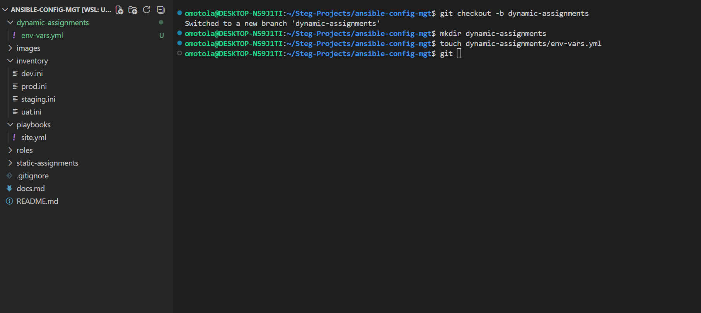

1. Create an `env-vars` directory containing YAML files for each environment (`dev.yml`, `stage.yml`, `uat.yml`, and `prod.yml`) to store environment-specific variables like server names and IP addresses.

```bash
mkdir env-vars
cd env-vars
touch dev.yml stage.yml uat.yml prod.yml

```
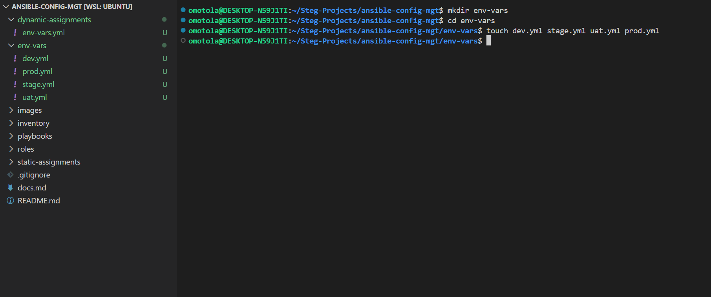


4. Paste the `include_vars` task into `dynamic-assignments/env-vars.yml`:
```yaml
---
- name: collate variables from env specific file, if it exists
  hosts: all
  tasks:
   
   name: looping through list of available files
      include_vars: "{{ item }}"
      with_first_found:
        - files:
            - "{{ inventory_file | basename }}"
            - dev.yml
            - stage.yml
            - prod.yml
            - uat.yml
          paths:
            - "{{ playbook_dir }}/../env-vars"
      tags:
        - always

```
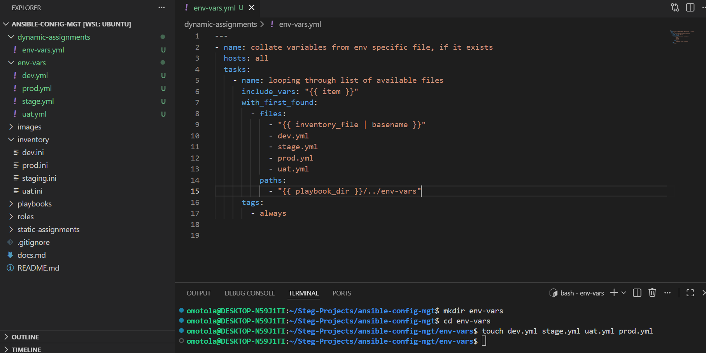

5. Update the `site.yml` file to make use of the dynamic assignment:
```yaml
---
- name: Include dynamic variables
  import_playbook: ../dynamic-assignments/env-vars.yml
  tags:
    - always

- import_playbook: ../static-assignments/common.yml

- name: Webserver assignment
  import_playbook: ../static-assignments/uat-webservers.yml

```


## 2. Community Roles (MySQL Role)

For the database layer, we use the MySQL role developed by `geerlingguy`, which installs the MySQL package, creates a database, and configures users.

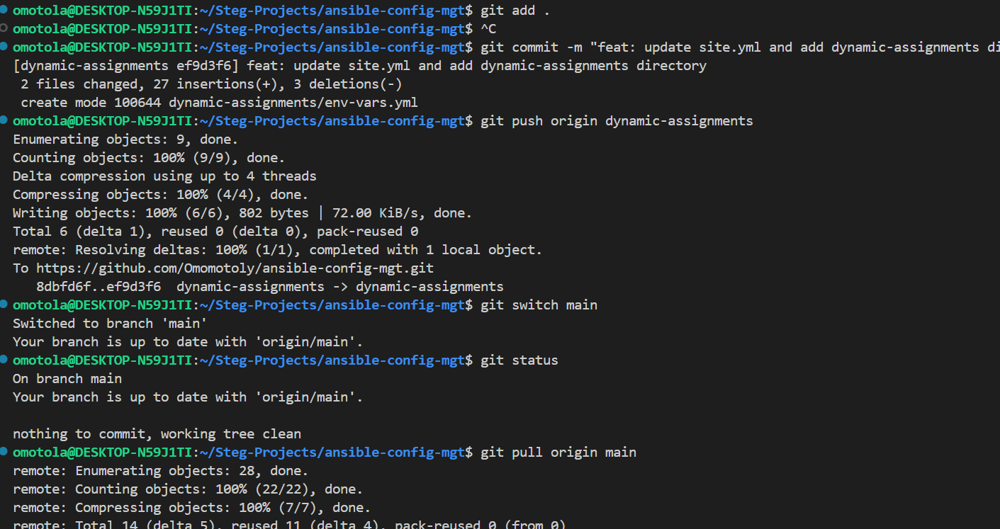
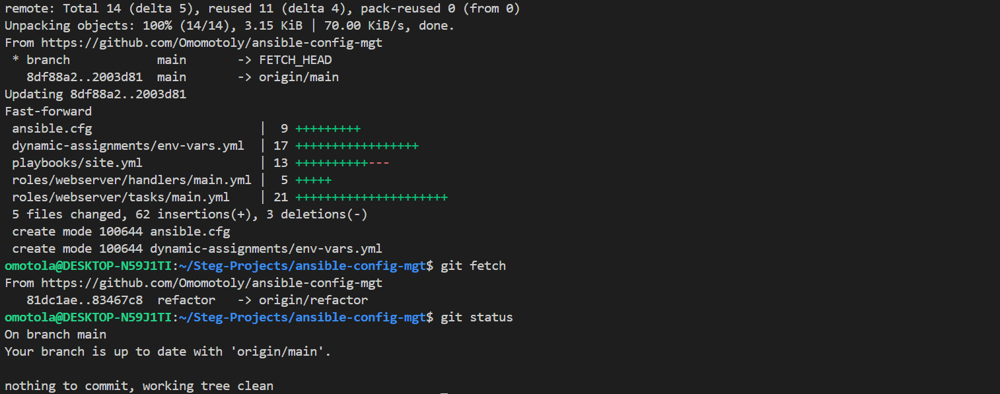

## Configure vscode to work with the directory (ansible-config-mgt)
### Configure SSH for vscode

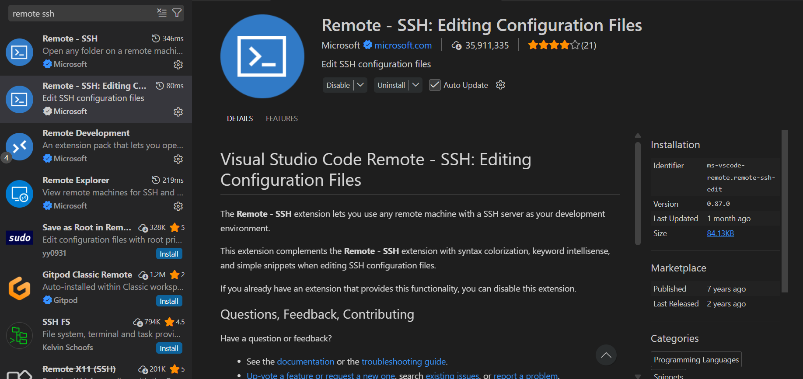

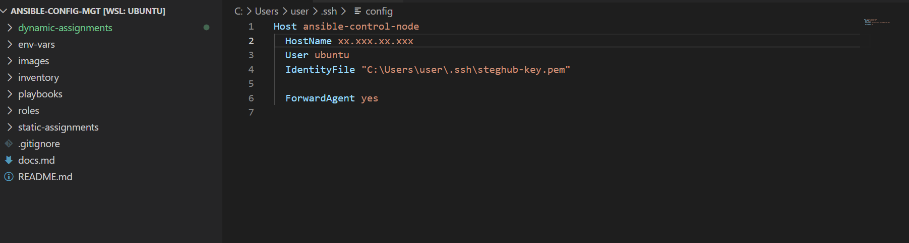

Click on Open Folder and Select ansible-config-mgt
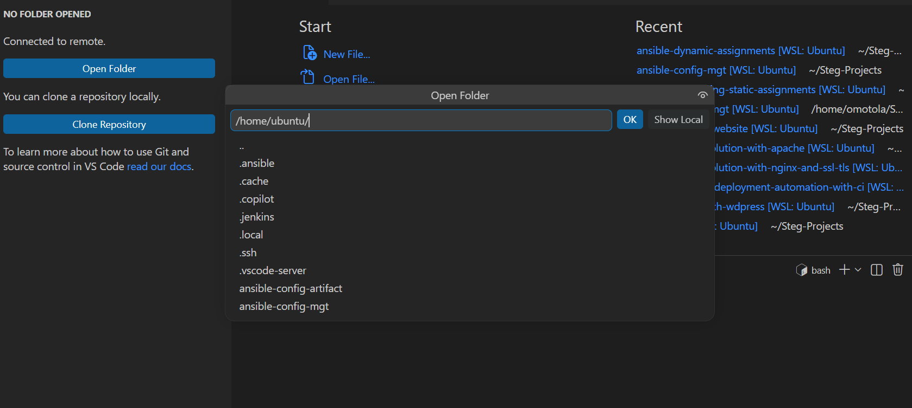

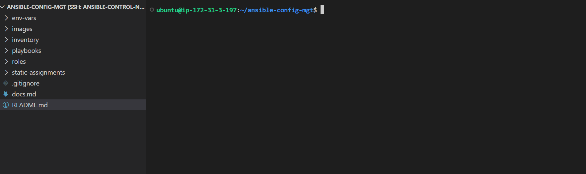

On Jenkins-Ansible server make sure that git is installed with git --version, then go to ansible-config-mgt directory and run
```
git init
git pull https://github.com/<your-name>/ansible-config-mgt.git
git remote add origin https://github.com/<your-name>/ansible-config-mgt.git
git branch roles-feature
git switch roles-feature
```
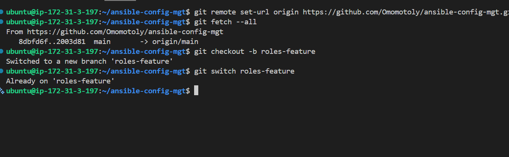

Inside the `roles` directory, install the MySQL role and rename the folder:
```bash
cd roles
ansible-galaxy install geerlingguy.mysql
mv geerlingguy.mysql mysql
```
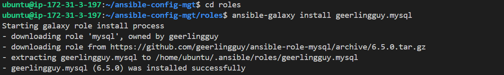

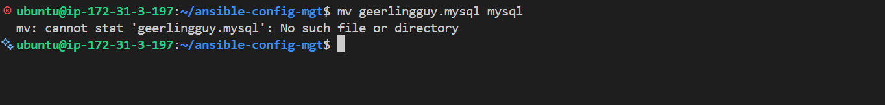

## Troubleshooting: Ansible Galaxy Role Path and Misplaced Downloads
* **Issue**

  Downloaded to the wrong directory: When I tried downloading geerlingguy.mysql using ansible-galaxy, it went straight into ~/.ansible/roles in my user home directory instead of my project's roles/ folder.

  Why it happened: In my ansible.cfg, I had set roles_path = roles (a relative path). Because I ran the command while already standing inside the roles/ folder, Ansible tried to look for roles/roles. Failing that, it silently fell back to the default ~/.ansible/roles location.   


  The problem: When I tried running `mv geerlingguy.mysql mysql` inside my project's roles/ folder, it failed because the role wasn't actually there—it was sitting in my global user directory.

* **Commands & Fix**

  Cleaned up and deleted the wrongly placed role:
  ```bash
  cd ../.ansible/roles/
  ls
  rm -rf geerlingguy.mysql
  ```
  

  Updated ansible.cfg to use the full absolute path:
  ```bash
  nano ansible.cfg
  ```

  ```ini
  [defaults]
  roles_path = /home/ubuntu/ansible-config-mgt/roles
  ```
  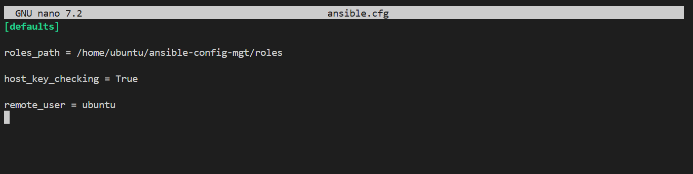

  Re-ran the installation command from the project root:
  ```bash
  cd ~/ansible-config-mgt 
  ansible-galaxy install geerlingguy.mysql
  ```
  Renamed the role folder to mysql inside the project roles directory:
  ```bash
  cd ~/ansible-config-mgt/roles
  mv geerlingguy.mysql mysql
  ```
  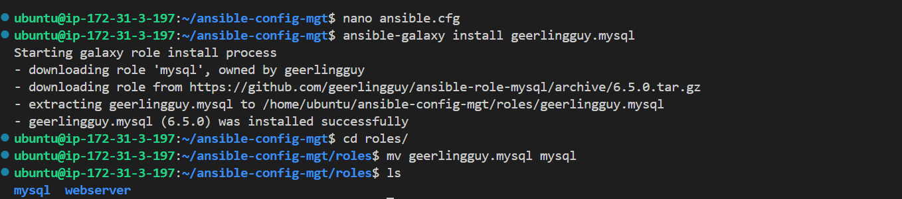
* **Result**

  - Cleaned out the misplaced files from ~/.ansible/roles.

  - Setting the full absolute path in ansible.cfg ensures that ansible-galaxy downloads always drop directly into my project's roles/ folder, regardless of which directory my terminal is currently in.

  - Successfully installed and renamed the MySQL role cleanly within my project repository.
---

Edit the role configuration to use the correct database credentials required for the `Tooling` website.

Create Database and mysql user (roles/mysql/vars/main.yml)

```yaml
mysql_root_password: super-secure-password
    mysql_databases:
      - name: example_db
        encoding: latin1
        collation: latin1_general_ci
    mysql_users:
      - name: example_user
        host: "%"
        password: similarly-secure-password
        priv: "example_db.*:ALL"
```
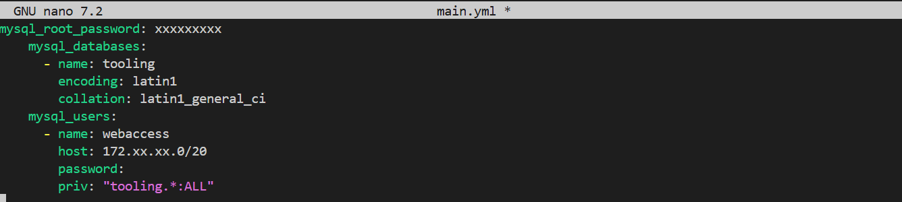

1. Upload the changes to GitHub:
```bash
git add .
git commit -m "Commit new role files into GitHub"
git push --set-upstream origin roles-feature

```
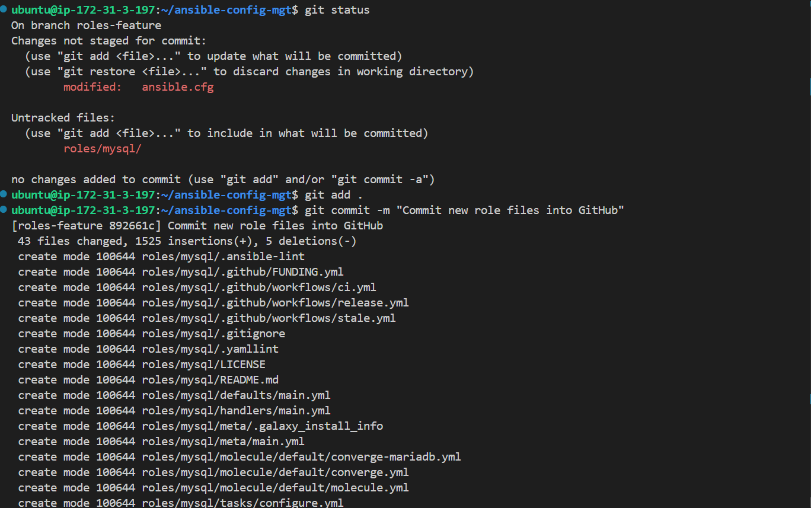
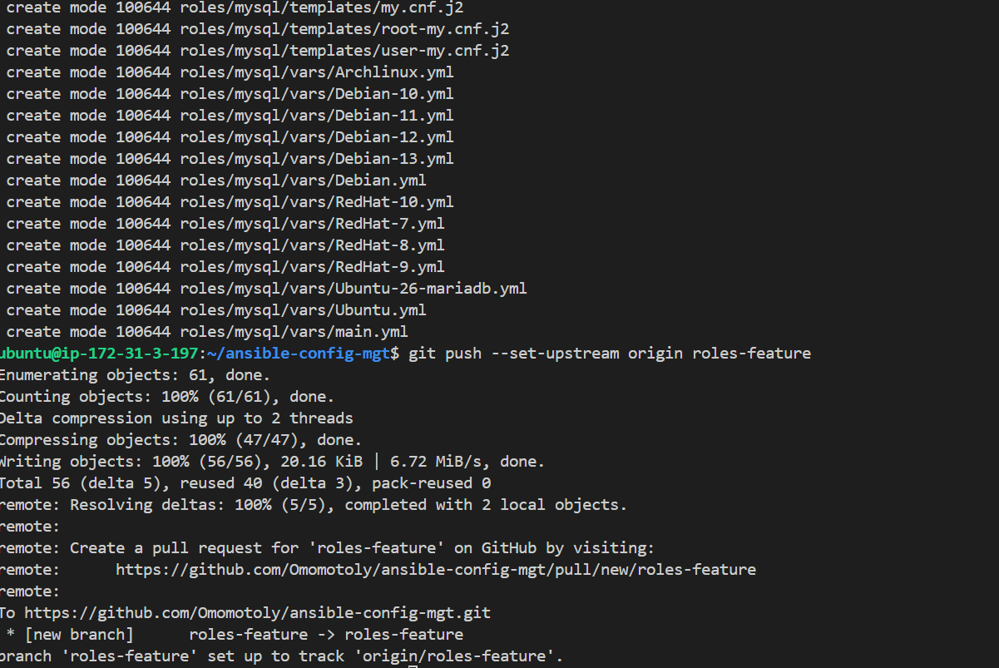

Add a new playbook inside static-assignments folder and name it db-servers.yml

```bash
nano static-assignments/db-servers.yml 
```
```yaml
- hosts: db_servers
  become: yes
  vars_files:
    - vars/main.yml
  roles:
    - { role: mysql }
```
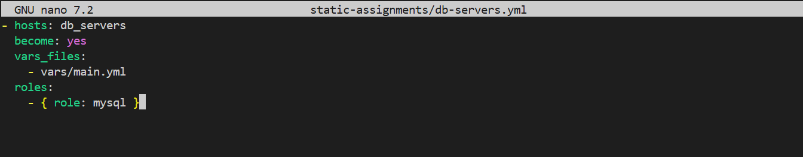

---

## 3. Load Balancer Roles

To give us the flexibility to choose between **Nginx** or **Apache** as the load balancer, we need to create and configure a role for each.

1. Create and switch to a new branch for load balancer roles work:
```bash
git checkout -b loadbalancer-roles

```


2. Install the Nginx and Apache roles into the `roles` directory:
```bash
cd roles
ansible-galaxy install geerlingguy.nginx -p /home/ubuntu/ansible-config-mgt/roles
ansible-galaxy install geerlingguy.apache -p /home/ubuntu/ansible-config-mgt/roles

```
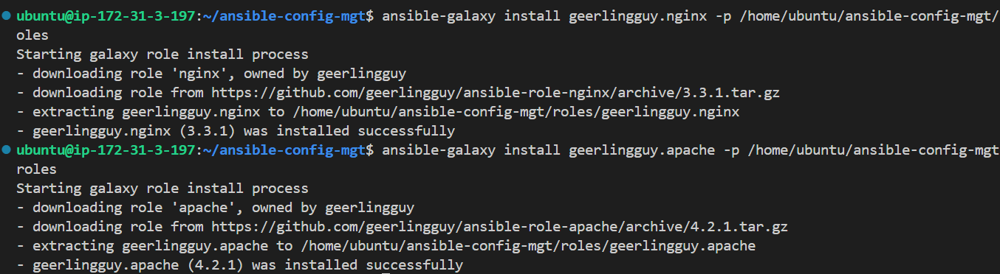


3. Rename the downloaded role folders:
```bash
mv geerlingguy.nginx nginx
mv geerlingguy.apache apache

```
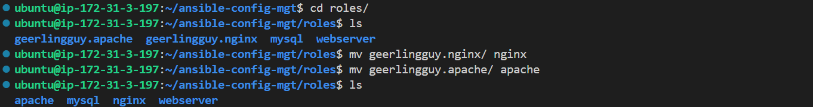


4. Add the load balancer toggles to `nginx/defaults/main.yml` and `apache/defaults/main.yml`.
For Nginx:
```yaml
# roles/nginx/defaults/main.yml
enable_nginx_lb: false
load_balancer_is_required: false
```
For Apache:
```yaml
# roles/apache/defaults/main.yml
enable_apache_lb: false
load_balancer_is_required: false
```
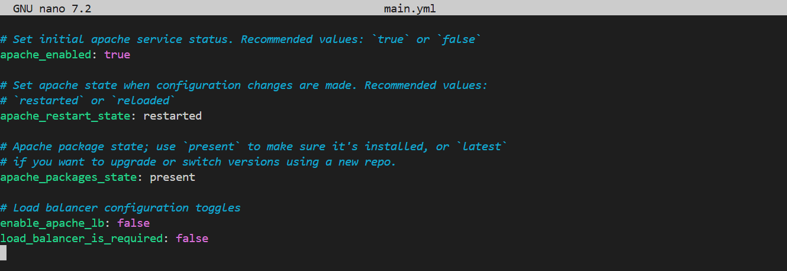
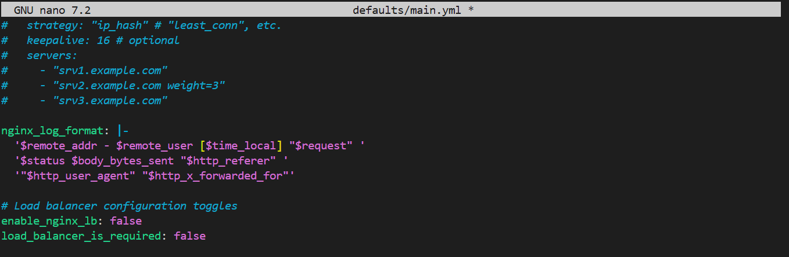

1. Create a `loadbalancers.yml` playbook in `static-assignments` that applies the Nginx or Apache role to the `lb` hosts:
```bash
nano static-assignments/loadbalancers.yml

```

```yaml
- hosts: lb
  become: true
  roles:
    - { role: nginx, when: enable_nginx_lb and load_balancer_is_required }
    - { role: apache, when: enable_apache_lb and load_balancer_is_required }

```
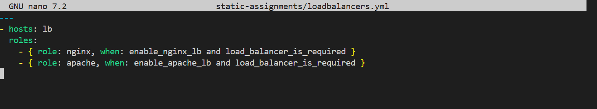


6. Update the `site.yml` file with the load balancers assignment:
```yaml
- import_playbook: ../static-assignments/loadbalancers.yml

```
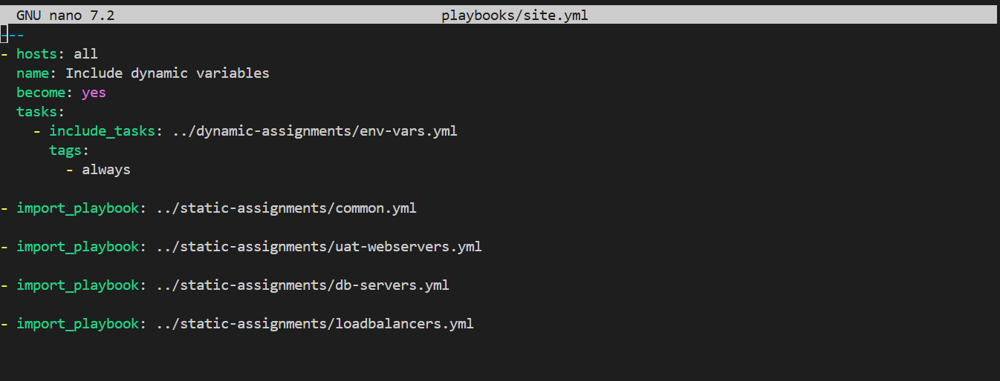

7. Update the `env-vars/uat.yml` file to activate the Nginx load balancer for UAT:
```yaml
enable_nginx_lb: true
load_balancer_is_required: true

```
curl -H "Host: app.local" http://172.31.xx.xxx/

8. Update the inventory file for the UAT environment (`inventory/uat.yml`):
```ini
[uat-webservers]
Web1 ansible_host=54.xx.xx.69 ansible_user=ec2-user
Web2 ansible_host=54.xx.xxx.71 ansible_user=ec2-user

[db_servers]
db ansible_host=18.xxx.xxx.233 ansible_ssh_user=ubuntu

[lb]
lb ansible_host=100.xx.xx.78 ansible_user=ubuntu

```


### Execution and Verification

1. Confirm that Ansible can reach all hosts in the inventory:
```bash
ansible all -i inventory/uat.ini -m ping

```
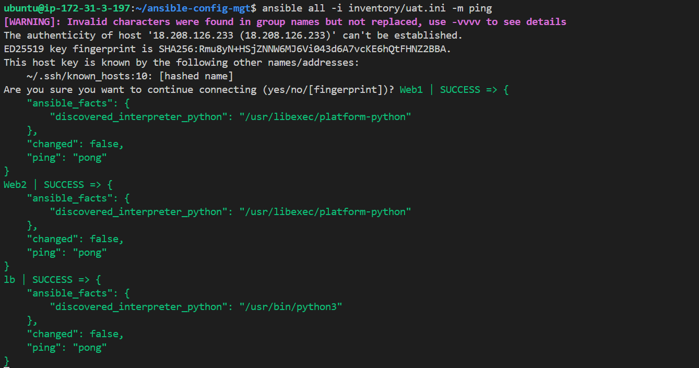

2. Run the Ansible playbook against the UAT environment:

```bash
ansible-playbook -i inventory/uat.ini playbooks/site.yml

```
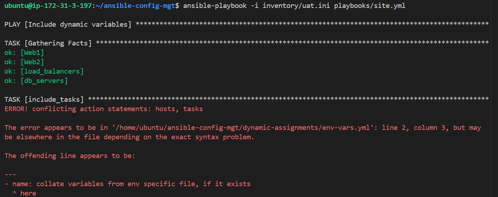
---
## Troubleshooting
* **Problem**: The file env-vars.yml was included via include_tasks, but it threw an error because it still had hosts: and tasks: wrappers. Since task files are meant to be simple, standalone lists of tasks, Ansible doesn't allow those structural headers inside them.

* **Resolution**: I opened `dynamic-assignments/env-vars.yml` and removed the play-level wrappers like `hosts:` and `tasks:` that were causing the conflict.
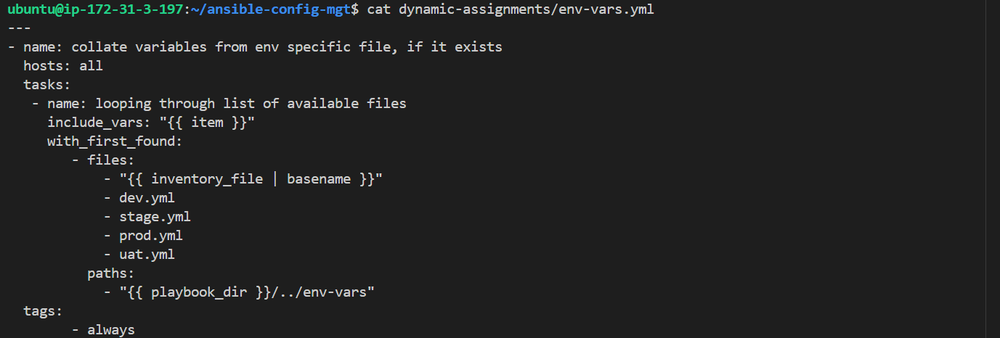

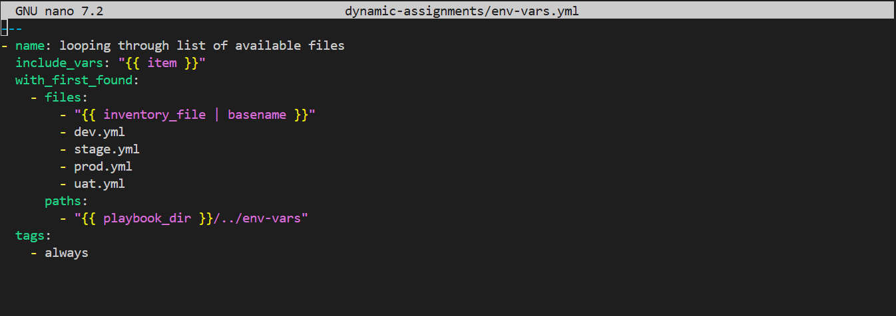
---
Run the playbook again

```bash
ansible-playbook -i inventory/uat.ini playbooks/site.yml

```
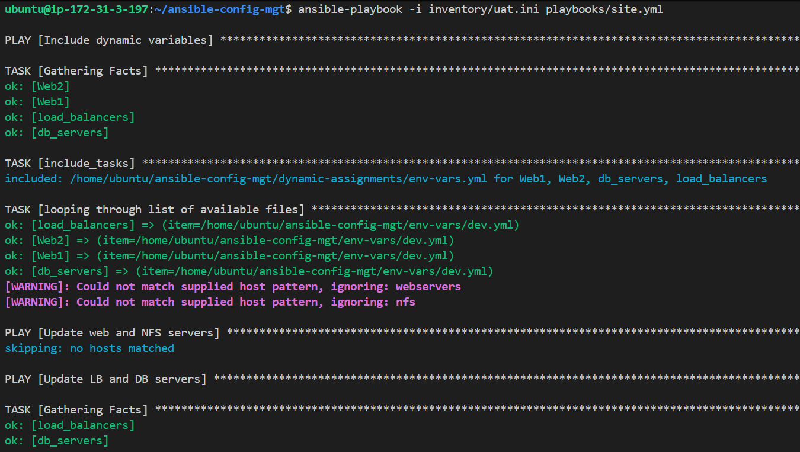
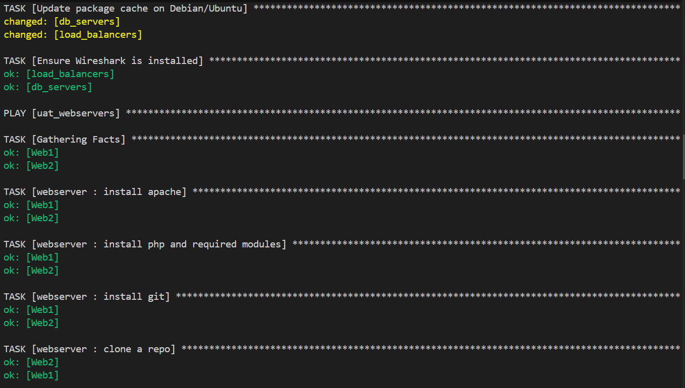
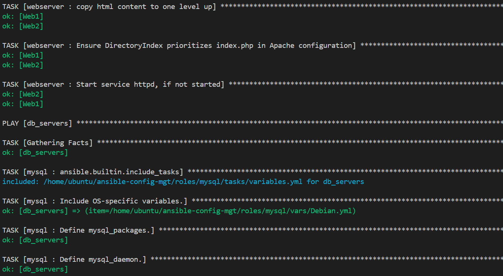
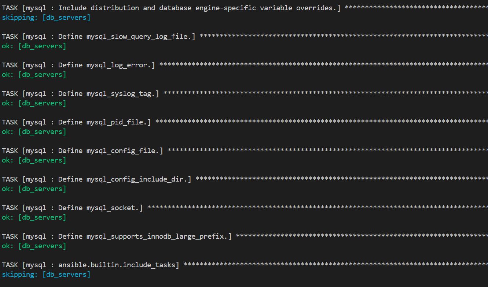
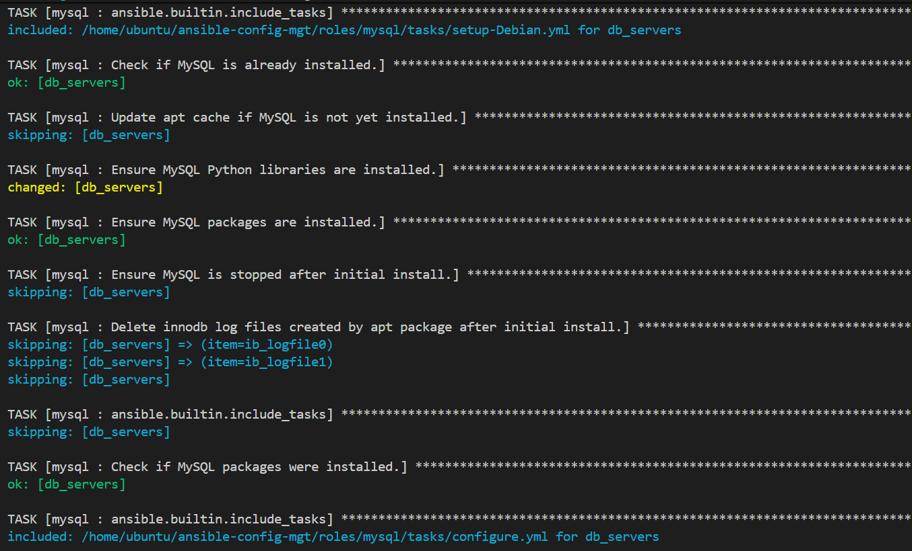
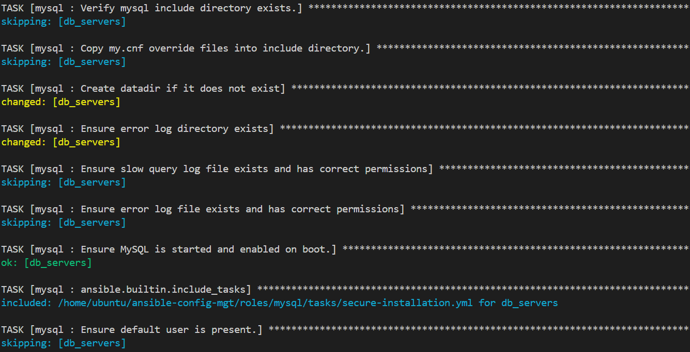
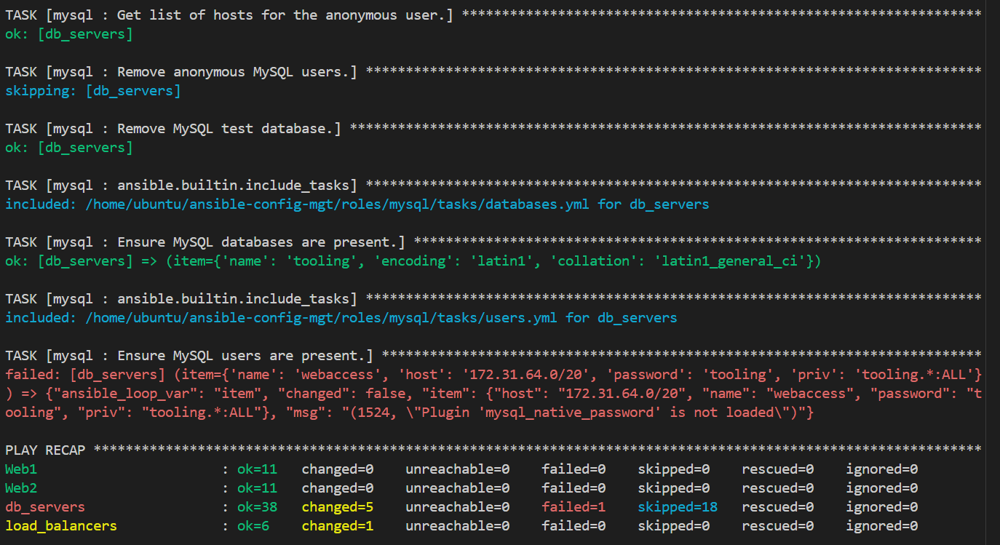

## Troubleshooting

  * **The Problem**: While configuring the MySQL database server with Ansible, I encountered an error when the playbook attempted to create the `webaccess` database user.

  The error message was:

  ```text
  (1524, "Plugin 'mysql_native_password' is not loaded")
  ```

  The database server was running **MySQL 8.4.11**. The problem was that the user configuration was attempting to use `mysql_native_password`, a legacy authentication plugin that is disabled by default in this MySQL version. Rather than enabling the legacy authentication plugin, I decided to use MySQL's newer authentication method, `caching_sha2_password`.

  This authentication method provides a more up-to-date approach to password authentication.

* **Resolution**: I updated the MySQL user configuration in:

  `roles/mysql/vars/main.yml`

  I explicitly specified `caching_sha2_password` as the authentication plugin.

  The updated configuration was:

  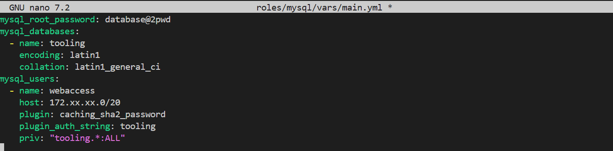

* **Result**: The issue was addressed by changing the authentication method from the legacy `mysql_native_password` to `caching_sha2_password`.

  This avoided the need to enable the legacy authentication plugin and aligned the Ansible configuration with the authentication method supported by MySQL 8.4.11.

## Configure Nginx Load Balancer

1\. Update Environment Variables (`env-vars/uat.yml`)

```bash
nano env-vars/uat.yml

```
```yaml
---
enable_nginx_lb: true
enable_apache_lb: false
load_balancer_is_required: true

# Remove default Nginx placeholder page
nginx_remove_default_vhost: true

# Define backend web server pool
nginx_upstreams:
  - name: web_backend_pool
    strategy: "least_conn"
    servers:
      - "172.xx.xx.128"  # Web1-UAT
      - "172.xx.xx.190"  # Web2-UAT

# Configure the load balancer virtual host
nginx_vhosts:
  - listen: "80"
    server_name: "app.local"  # Replace with domain or server IP
    extra_parameters: |
      location / {
          proxy_pass http://web_backend_pool;
          proxy_http_version 1.1;
          proxy_set_header Host $host;
          proxy_set_header X-Real-IP $remote_addr;
          proxy_set_header X-Forwarded-For $proxy_add_x_forwarded_for;
          proxy_set_header X-Forwarded-Proto $scheme;
      }

```
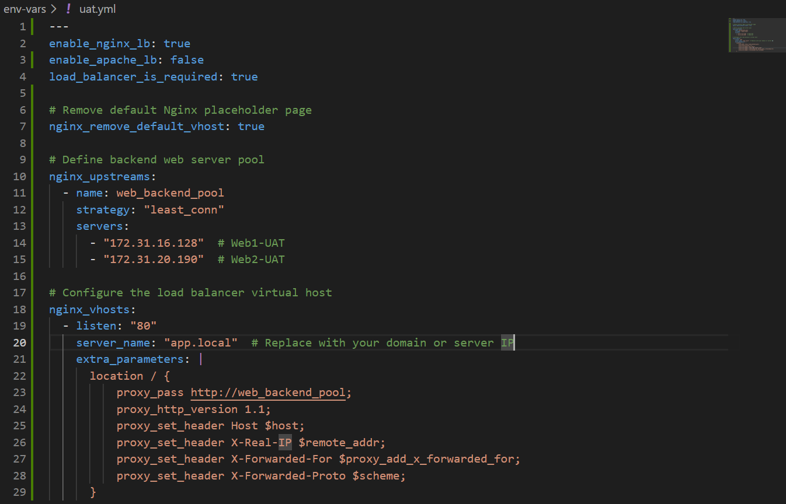

2\. Syntax Check the Playbook

  ```bash
  ansible-playbook -i inventory/uat.ini playbooks/site.yml --syntax-check

  ```
  Output should display `playbook: playbooks/site.yml` with zero syntax errors.

---

3\. Execute the Playbook

  Run the playbook to apply the configuration across UAT inventory:

  ```bash
  ansible-playbook -i inventory/uat.ini playbooks/site.yml

  ```

---
4\. Verify the Nginx Configuration File on the Load Balancer Server

Log into your Nginx load balancer server via SSH and inspect the generated configuration file to confirm that the upstream backend pools and virtual host rules were correctly rendered by Ansible.

SSH into the load balancer:
Check the contents of the main Nginx configuration located under /etc/nginx/sites-enabled
  ```bash
  sudo cat /etc/nginx/sites-enabled/app.local.conf 
  ```
  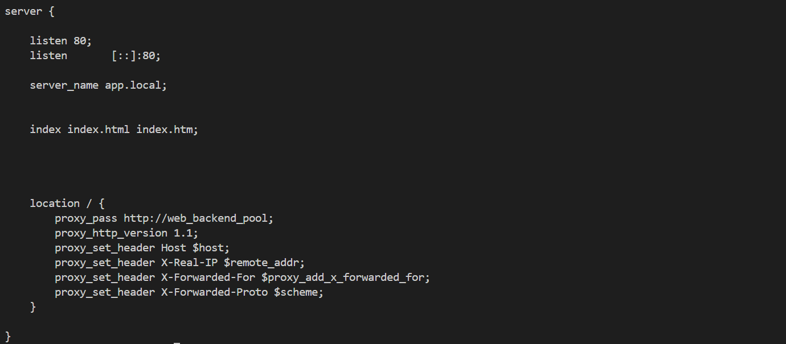
5\. Test Nginx Configuration Syntax

Before reloading Nginx, verify that the deployed configuration files contain no syntax errors or broken directives.

Run the built-in Nginx syntax check command on the load balancer server:
  ```bash
  sudo nginx -t
  ```
  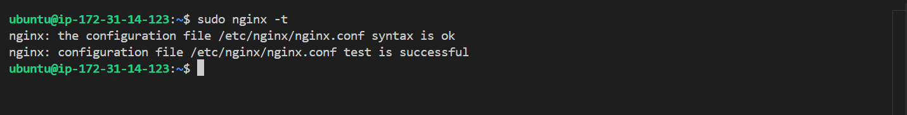

6\. Check Nginx Service Status

Confirm that the Nginx service is active, running, and successfully managing traffic after the deployment.
  ```bash
  sudo systemctl status nginx
  ```
  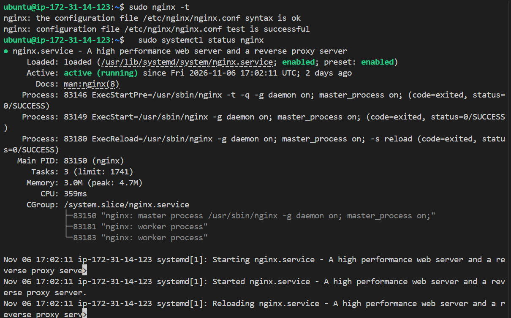

7\. Test Routing with cURL

Send requests to the load balancer's public IP:
  ```bash
  curl -H "Host: app.local" http://LOAD_BALANCER_PUBLIC_IP
  ```
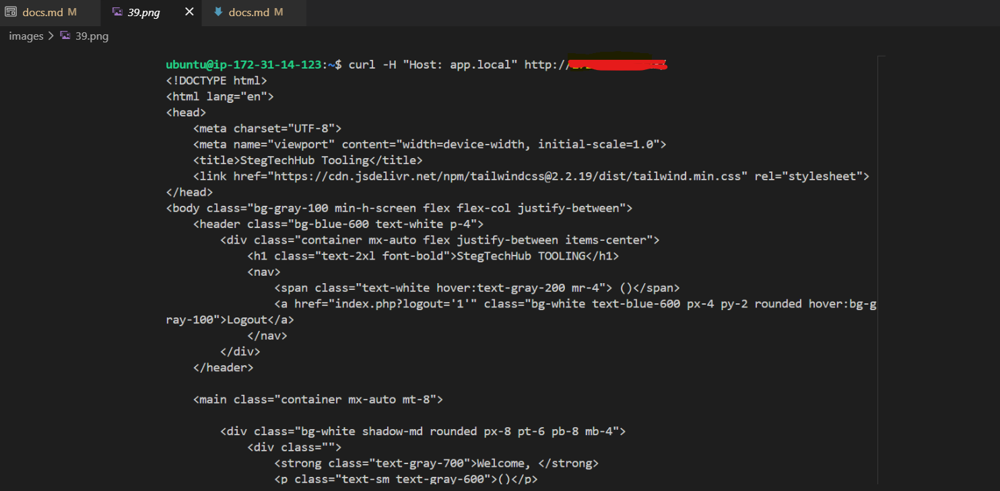

Run the command multiple times to ensure requests reach the upstream backend servers.

8\. Monitor Nginx Logs

SSH into the Nginx load balancer server and monitor traffic logs live:

```bash
sudo tail -f /var/log/nginx/access.log
```
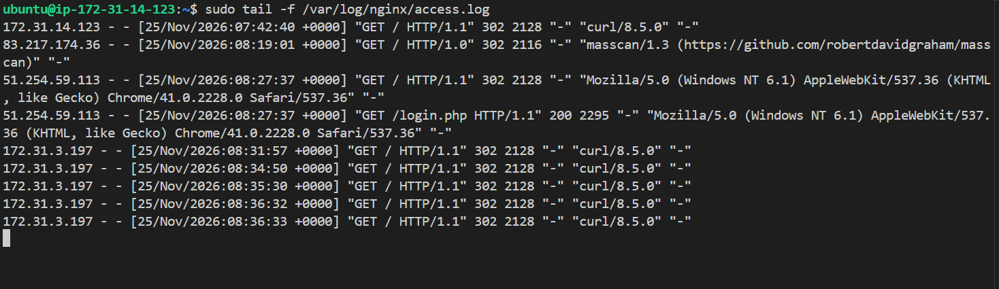

SSH into the backend servers to monitor how the loadbalancer distributes traffic across them.

```bash
sudo tail -f /var/log/httpd/access_log

```
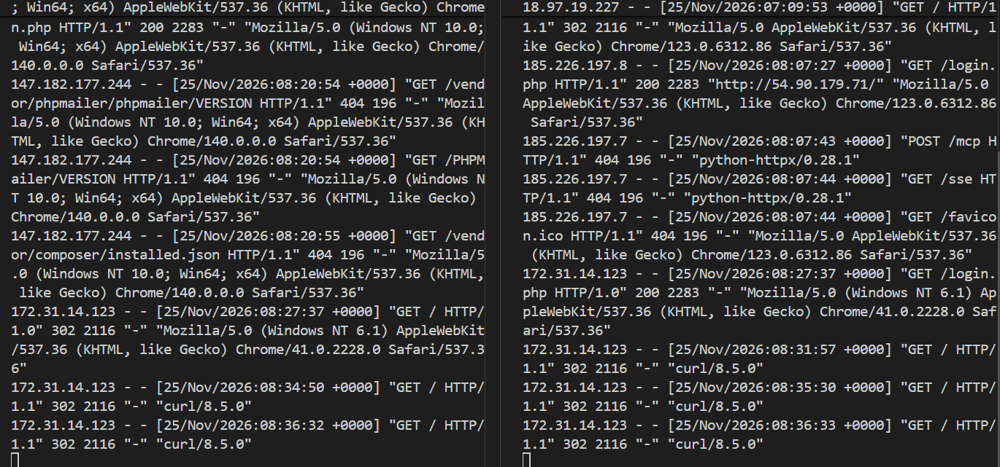

## Important Note
To keep our automation clean, modular, and easy to maintain, we are encapsulating our load-balancer configuration into a dedicated custom role rather than modifying rigid community roles. By separating our core deployment logic from environment-specific variables and toggle flags, we ensure that a single, reusable codebase can seamlessly switch between Nginx and Apache depending on the active environment settings.

Ensure the project root is organized as follows:
```Plaintext

ansible-config-mgt/
├── roles/
│   ├── nginx/                  # Community role
│   ├── apache/                 # Community role
│   └── custom_lb_config/       # Your new custom role
│       ├── defaults/
│       │   └── main.yml        # Default variables
│       ├── handlers/
│       │   └── main.yml        # Service restart handlers
│       ├── tasks/
│       │   └── main.yml        # Custom configuration tasks
│       └── templates/
│           ├── nginx.conf.j2   # Nginx load balancer template
│           └── apache.conf.j2  # Apache load balancer template
├── static-assignments/
│   └── loadbalancers.yml       # Playbook assigning roles to lb hosts
└── ansible.cfg
```
1\. Create Your Jinja2 Templates

Run the following shell commands from your project root directory to scaffold the role's directory structure and initialize the necessary files:
```bash
mkdir -p roles/custom_lb_config/{defaults,handlers,tasks,templates}
touch roles/custom_lb_config/defaults/main.yml
touch roles/custom_lb_config/handlers/main.yml
touch roles/custom_lb_config/tasks/main.yml
touch roles/custom_lb_config/templates/nginx.conf.j2
touch roles/custom_lb_config/templates/apache.conf.j2
```
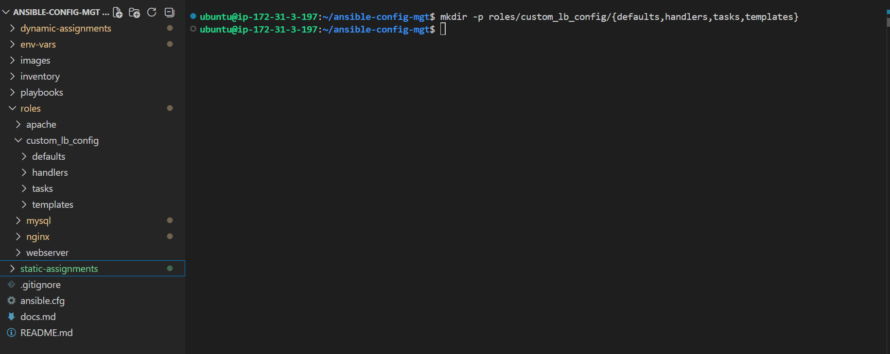

Nginx Template (roles/custom_lb_config/templates/nginx.conf.j2):
```

upstream {{ nginx_upstream_name | default('backend_servers') }} {

    {{ nginx_lb_strategy }};


    server {{ server }};

}

server {
    listen 80;
    server_name {{ lb_server_name | default('_') }};

    location / {
        proxy_pass http://{{ nginx_upstream_name | default('backend_servers') }};
        proxy_set_header Host $host;
        proxy_set_header X-Real-IP $remote_addr;
        proxy_set_header X-Forwarded-For $proxy_add_x_forwarded_for;
    }
}
```
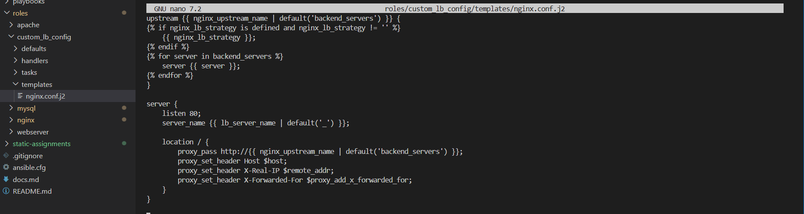

Apache Template (roles/custom_lb_config/templates/apache.conf.j2):
```

<VirtualHost *:80>
    ServerName {{ lb_server_name | default('localhost') }}

    <Proxy "balancer://{{ apache_cluster_name | default('mycluster') }}">

        BalancerMember http://{{ server }}

        ProxySet lbmethod={{ apache_lb_method | default('byrequests') }}
    </Proxy>

    ProxyPreserveHost On
    ProxyPass / balancer://{{ apache_cluster_name | default('mycluster') }}/
    ProxyPassReverse / balancer://{{ apache_cluster_name | default('mycluster') }}/
</VirtualHost>
```
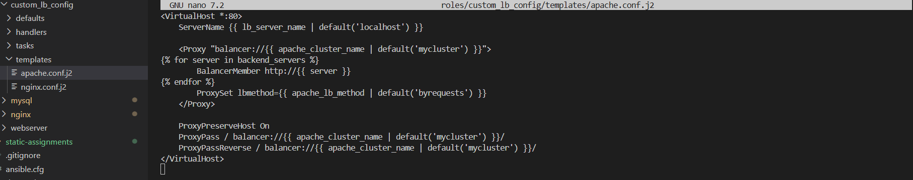

2\. Custom Role Tasks 
Tasks (roles/custom_lb_config/tasks/main.yml)

```yaml
---
- name: Remove default Nginx vhost if configured
  ansible.builtin.file:
    path: /etc/nginx/sites-enabled/default
    state: absent
  when: enable_nginx_lb | default(false) and nginx_remove_default_vhost | default(false)
  notify: Restart Nginx

- name: Deploy Nginx configuration from template
  ansible.builtin.template:
    src: nginx.conf.j2
    dest: /etc/nginx/conf.d/load-balancer.conf
  when: enable_nginx_lb | default(false)
  notify: Restart Nginx

- name: Deploy Apache load balancer configuration template
  ansible.builtin.template:
    src: apache.conf.j2
    dest: /etc/apache2/conf-enabled/load-balancer.conf
  when: enable_apache_lb | default(false)
  notify: Restart Apache

- name: Ensure active Nginx processes are stopped when using Apache
  ansible.builtin.service:
    name: nginx
    state: stopped
    enabled: false
  when: enable_apache_lb | default(false)
  ignore_errors: yes

```
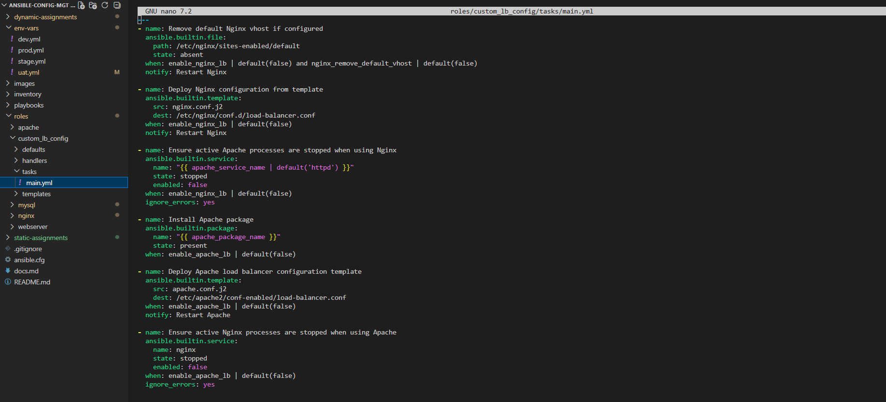

3\. Handlers (roles/custom_lb_config/handlers/main.yml)

```yaml
- name: Restart Nginx
  ansible.builtin.service:
    name: nginx
    state: restarted

- name: Restart Apache
  ansible.builtin.service:
    name: "{{ apache_service_name | default('apache2') }}"
    state: restarted
```
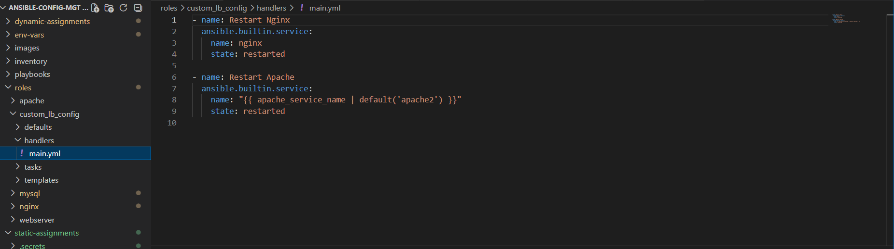

4\. Static Assignment Playbook (static-assignments/loadbalancers.yml)

Update loadbalancers static assignment to include the environment file alongside the custom role:
```yaml
---
- hosts: lb
  become: true
  vars_files:
    - ../envrs/uat.yml
  roles:
    - { role: nginx, when: enable_nginx_lb and load_balancer_is_required }
    - { role: apache, when: enable_apache_lb and load_balancer_is_required }
    - { role: custom_lb_config, when: load_balancer_is_required | default(false) }
```
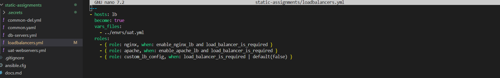

5\. Syntax Check the Playbook

  ```bash
  ansible-playbook -i inventory/uat.ini playbooks/site.yml --syntax-check
  ```
6\. Execute the Playbook

  Run the playbook to apply the configuration across UAT inventory:

  ```bash
  ansible-playbook -i inventory/uat.ini playbooks/site.yml
  ```

## Troubleshooting
Running Out of Disk Space During Ansible Deployment
While executing the Ansible playbook (playbooks/site.yml) against the UAT inventory, execution failed across all target nodes (Web1, Web2, load balancers, and database) due to an OSError: [Errno 28] No space left on device error. Running an ad-hoc Ansible disk utilization command (df -h) confirmed that disk space was fully exhausted, causing the playbook to crash repeatedly the exact moment execution started, even after temporary cleanups.
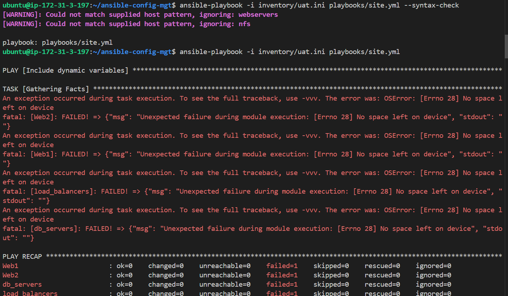


Attempts to run the playbook after the cleanup failed. To resolve this, new block storage volumes were created, partitions were resized, and filesystems were extended across the UAT servers and load balancer. However, running the playbook again resulted in the same storage error because the control node also required additional disk space to prepare, package, and stage startup modules before transferring them to the target servers. To fix this, the block storage volume on the control node was likewise increased, and its partition size and filesystem were expanded, allowing the playbook to run smoothly and complete successfully.

Next, an AnsibleUndefinedVariable error occurred during template deployment because the Jinja2 template (nginx.conf.j2) was iterating over backend_servers instead of the nginx_upstreams list defined in uat.yml. This was fixed by updating the template to loop through the nested nginx_upstreams and servers structure. An initial template syntax error involving an unclosed loop (Unexpected end of template. Jinja was looking for the following tags: 'endfor') was resolved by ensuring both nested loops were properly closed with matching  tags. 


All playbook tasks completed cleanly without undefined variable or unclosed block errors, successfully rendering and deploying the Nginx load balancer configuration to the target servers.


Following the successful deployment, inspection of the remote target server confirmed that the Nginx configuration was correctly rendered and written to /etc/nginx/conf.d/load-balancer.conf.


### **Configuring Load Balancer Role Execution and Service Switching**

```
---
- hosts: lb
  become: true
  vars_files:
    - ../envrs/uat.yml
  roles:
    - { role: nginx, when: enable_nginx_lb and load_balancer_is_required }
    - { role: apache, when: enable_apache_lb and load_balancer_is_required }
    - { role: custom_lb_config, when: load_balancer_is_required | default(false) }

```
To support switching between Nginx and Apache as the load balancer, the `loadbalancers.yml` playbook was updated to control the order in which the roles execute.

**Updated**`static-assignments/loadbalancers.yml`**:**

```
---
- hosts: lb
  become: true
  vars_files:
    - ../envrs/uat.yml

  roles:
  
    - { role: custom_lb_config, when: load_balancer_is_required | default(false) }
    - { role: nginx, when: enable_nginx_lb and load_balancer_is_required }
    - { role: apache, when: enable_apache_lb and load_balancer_is_required }
    
```

**Why the role order matters**

The `custom_lb_config` role is executed first so that its configuration and service-switching tasks run before the selected load balancer role attempts to start its service.

This is important because Nginx and Apache both use port 80 by default. If the previously active service is still running, the selected service may fail to start because the port is already occupied.


## Troubleshooting 

### Problem
During the switch from Nginx to Apache, the playbook failed at:

```
TASK [apache : Ensure Apache has selected state and enabled on boot.]

fatal: [load_balancers]: FAILED!
Unable to start service apache2:
Job for apache2.service failed because the control process exited with error code.
```


To find why apache2 could not start, I ran some configuration check against the load balancer hosts:

```bash
ansible lb -i inventory/uat.ini -b -m command -a "apachectl configtest"
```
The output error was:

```text
Invalid command '<Proxy', perhaps misspelled or defined by a module not included in the server configuration.
```


### 2. Root Cause

The required Apache proxy modules were not enabled. Although Apache was installed through the community Apache role, the modules required for reverse proxying and load balancing were missing.

### 3. Resolution: Enable Apache Proxy Modules

Added a task to the custom `custom_lb_config` role to enable the required modules:

- `proxy` – Allows Apache to forward requests to other servers.
- `proxy_http` – Enables HTTP communication with backend servers.
- `proxy_balancer` – Enables distribution of requests across backend servers.
- `lbmethod_byrequests` – Provides request-based load distribution.

Ansible implementation:

```yaml
- name: Enable Apache proxy modules
  community.general.apache2_module:
    name: "{{ item }}"
    state: present
  loop:
    - proxy
    - proxy_http
    - proxy_balancer
    - lbmethod_byrequests
  when: enable_apache_lb | default(false) | bool
  notify: Restart Apache
```

### 4. Second Issue: Invalid Load-Balancing Method

After enabling the proxy modules, Apache reported another error:

```text
ProxySet: unknown lbmethod lbmethod=bybusyness
```

The configuration was referencing `bybusyness`, but the corresponding load-balancing module was not enabled.

**Resolution:** Changed the load-balancing method in the UAT variables from `bybusyness` to `byrequests`.

```yaml
apache_lb_method: byrequests
```

### 5. Validation and Testing

All diagnostic commands were executed remotely from the Ansible control node without entering the servers through an interactive SSH session.

**Check Apache modules:**

```bash
ansible lb -i inventory/uat.ini -b -m command -a "apache2ctl -M"
```

**Validate Apache configuration:**

```bash
ansible lb -i inventory/uat.ini -b -m command -a "apachectl configtest"
```

Expected output:

```text
Syntax OK
```


**Inspected the deployed configuration**

- Checked the deployed load balancer configuration on the load balancer server using 

```bash
cat /etc/apache2/conf-enabled/load-balancer.conf
```
- Tested HTTP response headers and status


**Result**

Resolved the Apache startup errors by enabling the required proxy modules and correcting the load-balancing method.

Apache now starts successfully and is configured to distribute incoming HTTP requests across the defined backend web servers using the `byrequests` load-balancing method.
# Project Improvements and Configuration Updates

## 1. MySQL Credential Management and Authentication

As part of improving the security and configuration of my project, I revisited how MySQL credentials were managed within the Ansible role.

### Credential management with Ansible Vault

I moved the MySQL root and application user credentials out of plaintext configuration and implemented Ansible Vault to protect them.

The changes I made include:

- Created `roles/mysql/vars/vault.yml` to store encrypted credentials.
- Updated `roles/mysql/vars/main.yml` to reference Vault variables instead of hardcoded passwords.
- Updated `docs.md` to remove plaintext credentials and use sanitized variable references.

I also updated how I execute the playbook to supply the Vault password:

```bash
ansible-playbook -i inventory/uat.yml playbooks/site.yml --ask-vault-pass
```


### Fixing MySQL root authentication

While testing the changes, I encountered this authentication error:

```text
ERROR 1045 (28000): Access denied for user 'root'@'localhost' (using password: NO)
```

After investigating, I discovered that the Jinja2 template responsible for generating `/root/.my.cnf` was not including the root password because of its conditional logic.

I corrected `roles/mysql/templates/root-my.cnf.j2` to explicitly include the password and socket configuration:

```jinja2
[client]    
user="{{ mysql_root_username }}"
password="{{ mysql_root_password }}"
socket={{ mysql_socket }}
```

This resolved the mismatch between the generated client configuration and the password-based authentication required by the MySQL root account.

### Files updated

| File | What I changed |
|---|---|
| `roles/mysql/vars/vault.yml` | Added encrypted database credentials |
| `roles/mysql/vars/main.yml` | Replaced hardcoded passwords with Vault references |
| `roles/mysql/templates/root-my.cnf.j2` | Corrected root client authentication |
| `docs.md` | Removed plaintext credentials |

---

## 2. Load Balancer Environment-Variable Path Correction

### Changes Made
I corrected the environment-variable path in `static-assignments/loadbalancers.yml`, changing it from `../envrs/uat.yml` to `../env-vars/uat.yml` to match the actual directory structure in the repository. This ensures the playbook uses the correct file when the project is cloned and run elsewhere.

---

## 3. Staging Dynamic-Variable Mapping Standardization

### Changes Made
I standardized the staging environment naming across the inventory file, environment-variable file in `env-vars/`, and the `with_first_found` sequence. I used `staging` as the consistent identifier, replacing the previous mismatch between `staging.ini` and `stage.yml`.

This ensures that staging executions resolve and load the correct environment variables instead of potentially falling back to `dev.yml`. I also verified inventory resolution and playbook execution with the updated configuration.


---

## 4. Database Play `vars_files` Cleanup (`db-servers.yml`)

### Changes Made
I removed the unnecessary `vars_files` reference to `vars/main.yml` from `db-servers.yml`. The MySQL role already manages its own variables, so the playbook no longer needs to reference an unrelated variable file.

---

## 5. Inventory Group and Host Naming Standardization

### Changes Made
I updated the UAT database inventory to use `[db_servers]` instead of `[db]`, aligning it with the database play's `hosts: db_servers` declaration. I also gave the database host a more descriptive name to make the inventory easier to understand and maintain.

---

## 6. Documentation Log Path and Command Alignment

### Changes Made
I corrected the Nginx log paths in `docs.md` to reflect the actual Nginx log locations, replacing the incorrect Apache log reference with `/var/log/nginx/access.log`. I kept Apache-specific log paths under the Apache verification section.


---
### 7. Evidence of Successful Run


